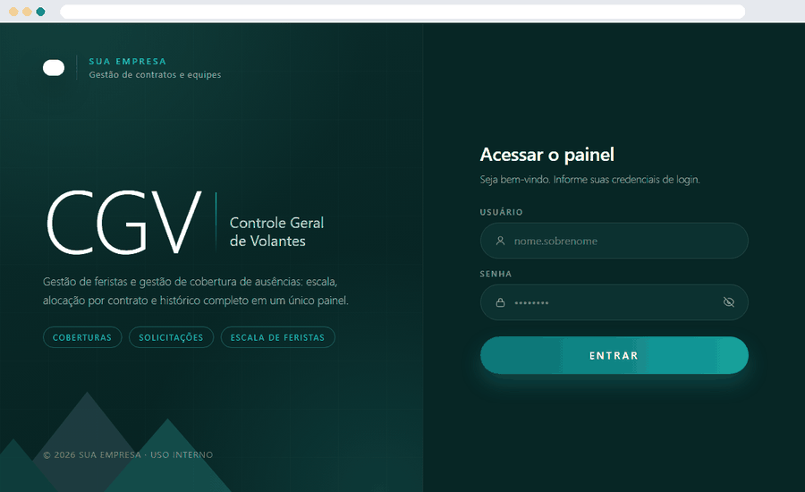
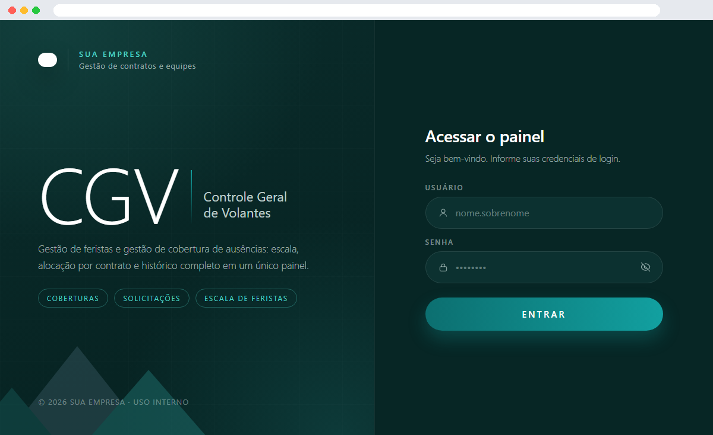
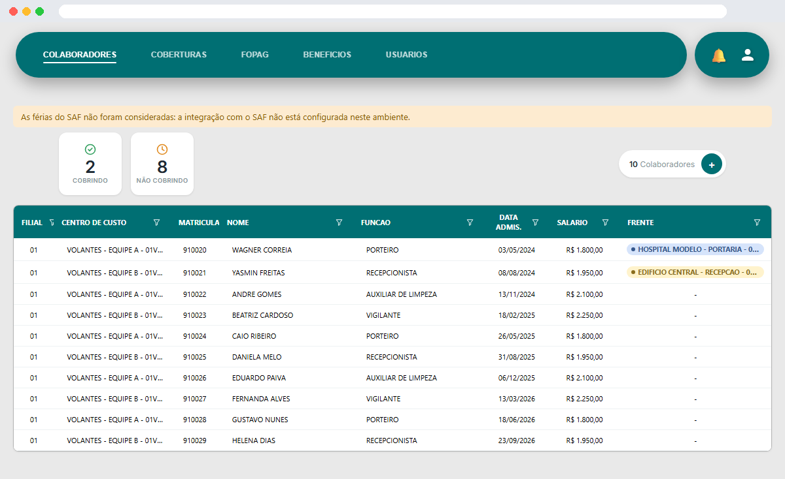
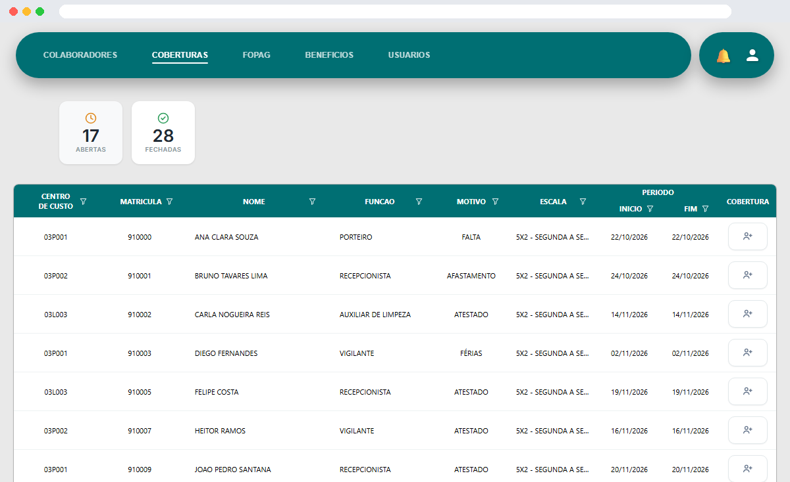
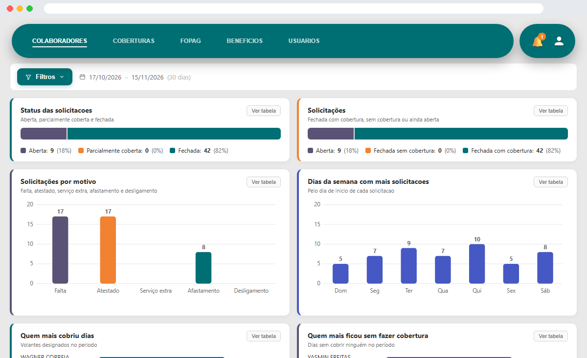
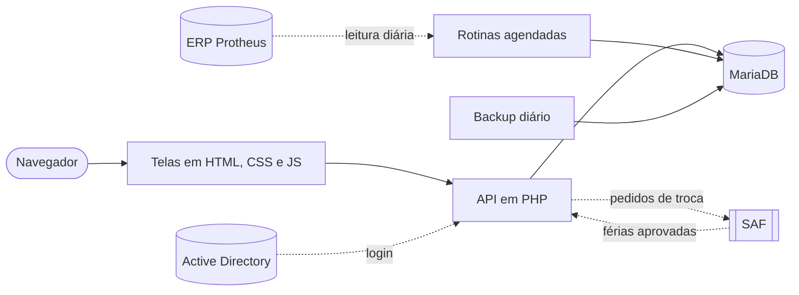

<p align="center"></p>

<p align="center">

    

</p>

<p align="center"></p>

# CGV · Controle Geral de Volantes

🇧🇷 [Português](#português) · 🇺🇸 [English](#english)

---

## Português

Sistema web para empresas de terceirização de serviços, que mantêm equipes alocadas em postos de trabalho dentro dos clientes e precisam garantir que nenhum posto fique descoberto.

Nesses contratos, um posto sem ninguém significa serviço não prestado e desconto na fatura (glosa). Por isso, a cada falta, atestado, férias, afastamento ou desligamento, a empresa precisa enviar um volante ou um intermitente para cobrir o posto. O CGV organiza esse processo de ponta a ponta: registra a ausência, mostra quem está disponível, guarda quem cobriu cada posto em cada dia e calcula, no fechamento do mês, os dias cobertos e os não cobertos por contrato.

Está em uso em produção, controlando mais de 6.000 colaboradores.

> Esta é a versão de portfólio: dados, endereços e configurações da empresa foram removidos. Os dados de teste são fictícios.

### O que o sistema faz

- **Solicitações de cobertura** por motivo: falta, atestado, férias, afastamento, desligamento, transferência e serviço extra.
- **Designação de volantes** dia a dia, com controle de quem está ocioso e de quem já está cobrindo.
- **Vagas em aberto** para afastamentos e desligamentos sem data de fim, com fechamento manual ou automático.
- **Fechamento mensal (PFM)**: cálculo dos dias cobertos e não cobertos por contrato, com prazo de ajuste.
- **Previsão de férias**, integrada ao [SAF](https://github.com/Igor-Wendel/SAF).
- **Dashboard** de indicadores: dias cobertos, glosa, ociosidade e ranking de coberturas.
- **Notificações** no sistema e mensagens prontas para avisar o colaborador.
- **Auditoria e logs** de todas as alterações.

### Perfis de acesso

| Perfil | O que faz |
|---|---|
| Administrador | Configura o sistema, usuários e consulta a auditoria |
| RH | Designa volantes, acompanha o fechamento e cancela solicitações |
| Gestor | Acompanha os volantes e contratos liberados para ele |
| Preposto | Abre e acompanha as solicitações dos seus postos |

### Telas

Capturas feitas com dados fictícios.

<details>
<summary><b>Login</b></summary>
<br>

</details>

<details open>
<summary><b>Funcionários: quem está cobrindo e onde</b></summary>
<br>

</details>

<details>
<summary><b>Solicitações de cobertura</b></summary>
<br>

</details>

<details>
<summary><b>Dashboard de indicadores</b></summary>
<br>

</details>

### Arquitetura



### Integrações

- **ERP TOTVS Protheus**: sincronização diária, somente leitura, de colaboradores e centros de custo.
- **Diretório LDAP / Active Directory**: login com a conta de rede.
- **SAF**: leitura das férias aprovadas e envio de pedidos de troca de cobertura, por arquivos JSON.
- **SMTP**: envio de e-mails com PHPMailer.

Todas são opcionais e configuradas por variável de ambiente.

### Tecnologias

| Camada | Tecnologia |
|---|---|
| Backend | PHP (sem framework), PDO |
| Banco de dados | MariaDB, com migrações versionadas |
| Frontend | HTML, CSS e JavaScript puro |
| Infraestrutura | Docker e Docker Compose |
| Rotinas | scripts agendados (sincronização, fechamento automático, backup) |

### Como rodar localmente

```bash
cp .env.example .env        # ajuste as senhas
docker compose up -d
```

Acesse `http://localhost:8090` com o usuário `Admin` e a senha `demo1234`. Troque a senha no primeiro acesso.

### Estrutura

```
backend/api/       endpoints da API
backend/scripts/   rotinas agendadas e testes
backend/schema.sql estrutura do banco
coberturas/        telas de solicitação, previsão, PFM e dashboard
colaboradores/     telas de funcionários
ferramentas/       migração do banco e utilitários
frontend/          estilos e imagens
```

### Autor

Igor Wendel · [github.com/Igor-Wendel](https://github.com/Igor-Wendel)

---

## English

Web system for outsourcing and facility services companies, which keep staff assigned to positions at their clients' sites and must make sure no position is left uncovered.

In these contracts, an empty position means service not delivered and a deduction on the invoice. So for every absence, sick leave, vacation, leave or termination, the company has to send a relief or on-call worker to cover the position. CGV handles the whole process: it records the absence, shows who is available, keeps track of who covered each position each day and calculates, at month closing, the covered and uncovered days per contract.

It runs in production, managing more than 6,000 employees.

> This is the portfolio version: company data, addresses and settings were removed. Test data is fictional.

### What it does

- **Coverage requests** by reason: absence, sick leave, vacation, leave, termination, transfer and extra work.
- **Daily assignment of relief workers**, tracking who is idle and who is already covering.
- **Open-ended vacancies** for leaves and terminations, closed manually or automatically.
- **Monthly closing**: covered and uncovered days per contract, with an adjustment window.
- **Vacation forecast**, integrated with [SAF](https://github.com/Igor-Wendel/SAF).
- **Dashboard**: covered days, penalties, idleness and coverage ranking.
- **Notifications** in the app and ready-made messages for workers.
- **Audit trail and logs** for every change.

### Roles

| Role | What it does |
|---|---|
| Administrator | Configures the system and users, reads the audit trail |
| HR | Assigns relief workers, follows the closing, cancels requests |
| Manager | Follows the workers and contracts released to them |
| Site supervisor | Opens and follows requests for their positions |

### Integrations

- **TOTVS Protheus ERP**: daily read-only sync of employees and cost centers.
- **LDAP / Active Directory**: network account login.
- **SAF**: reads approved vacations and sends coverage change requests through JSON files.
- **SMTP**: e-mail delivery with PHPMailer.

All of them are optional and set through environment variables.

### Stack

| Layer | Technology |
|---|---|
| Backend | PHP (no framework), PDO |
| Database | MariaDB, with versioned migrations |
| Frontend | HTML, CSS and vanilla JavaScript |
| Infrastructure | Docker and Docker Compose |
| Jobs | scheduled scripts (sync, automatic closing, backup) |

### Running locally

```bash
cp .env.example .env        # set the passwords
docker compose up -d
```

Open `http://localhost:8090` and sign in as `Admin` with password `demo1234`. Change the password on first access.

### Author

Igor Wendel · [github.com/Igor-Wendel](https://github.com/Igor-Wendel)

---

## Aviso legal · Legal notice

**PT:** © Igor Wendel. Todos os direitos reservados. O código está publicado para fins de portfólio e estudo; não há licença de uso, cópia ou redistribuição sem autorização do autor. Este repositório não contém dados reais de pessoas ou de empresas: nomes, matrículas e valores nos testes e exemplos são fictícios. Bibliotecas de terceiros mantêm suas próprias licenças: PHPMailer (LGPL-2.1). TOTVS e Protheus são marcas de seus titulares; este projeto não tem vínculo com eles. O software é fornecido "como está", sem garantias.

**EN:** © Igor Wendel. All rights reserved. The code is published for portfolio and study purposes; no license is granted to use, copy or redistribute it without the author's permission. This repository contains no real personal or company data: names, IDs and amounts in tests and examples are fictional. Third-party libraries keep their own licenses: PHPMailer (LGPL-2.1). TOTVS and Protheus are trademarks of their owners; this project is not affiliated with them. The software is provided "as is", without warranty.
